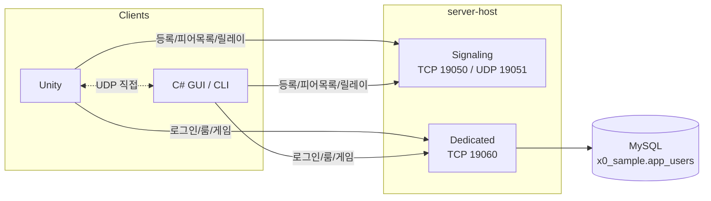

# rust_multiplay

Rust로 만든 멀티플레이 서버랑 테스트용 클라이언트 모음입니다.

서버 하나(`server-host`)에 P2P 시그널링 서버와 Dedicated 서버가 같이 떠 있고,
Unity 클라와 C# 클라(WinForms GUI, 콘솔)가 같은 프로토콜로 붙습니다.

할 수 있는 것

- UDP 홀펀칭으로 P2P 연결. 펀칭이 안 되면 시그널링 서버가 대신 릴레이
- 룸 번호로 묶기. 먼저 들어온 사람이 방장이고, 방장이 나가면 다음 사람이 이어받음
- 룸 전체 채팅, 귓속말
- MySQL 회원 로그인, 로비, 룸 생성/참가, 20Hz 게임 상태 동기화
- 통합 테스트, 시퀀스 테스터(CLI/GUI), C# selftest

## 구조



메시지는 JSON 한 줄씩(`\n` 구분) 주고받습니다. 형식은[appsettings.json](config/appsettings.json) `{"t":타입,"p":내용,"ts":unixMs}`.

## 필요한 것

- Rust stable
- .NET 8 SDK (C# 클라)
- Unity 6000.5.1f1 (Unity 클라 쓸 때만)
- MySQL 5.7 이상
- Windows 10/11 (`scripts/*.ps1`, WinForms GUI)

서버랑 C# CLI는 리눅스/맥에서도 빌드는 됩니다. 스크립트랑 GUI만 윈도우 전용이에요.

## 실행해 보기

```powershell
git clone https://github.com/juhyunkwon/rust_multiplay.git
cd rust_multiplay

# DB 만들기 (테이블 + 테스트 계정)
mysql -u root -p < sql/001_app_users.sql
mysql -u root -p < sql/002_dummy_users.sql

# 서버 설정. 이 파일은 git에 안 올라갑니다
copy config\appsettings.example.json config\appsettings.json
notepad config\appsettings.json

.\scripts\build.ps1          # Rust, C# 빌드해서 _bin 에 모음
.\scripts\run-server.ps1     # 서버
.\scripts\run-gui.ps1 -Two   # 클라 창 2개
```

창 두 개에서 `boy1` / `boy2`로 로그인하고 같은 방에 들어가면 P2P가 알아서 붙습니다.
피어 목록에서 상대를 누르면 귓속말, `Esc` 누르면 다시 전체 채팅입니다.

DB 없이 돌아가는지만 보고 싶으면 `cargo test --workspace` 하면 됩니다.
임시 포트랑 메모리 회원 저장소로 서버를 띄워서 테스트합니다.

## 설정

설정 파일은 `config/appsettings.json` 하나뿐입니다. 서버, 시퀀스 테스터, C# GUI/CLI, Unity 전부 이 파일을 읽습니다.
`appsettings.example.json`을 복사해서 DB 접속 정보만 채우면 됩니다.

```json
"ConnectionStrings": {
  "Default": "Server=127.0.0.1;Port=3306;Database=x0_sample;User=YOUR_USER;Password=YOUR_PASSWORD;"
}
```

그 외 항목

- `DedicatedServer.Host` / `Port` : 기본 127.0.0.1 / 19060
- `SignalingServer.Host` / `TcpPort` / `UdpPort` : 기본 127.0.0.1 / 19050 / 19051
- `Encryption.Key` : 비우면 평문, 넣으면 AES-CBC로 암호화 (서버/클라 같은 값)
- `Login` / `LoginB` : 클라 기본 로그인 계정 (A, B)
- `Logging.LogPath` : 로그 폴더, 기본 `_log`
- `ServerCapacity.MaxRooms` / `MaxPlayersPerRoom` : 기본 100 / 1000

파일 찾는 순서

1. 환경변수 `CONFIG_PATH` (폴더나 파일 경로)
2. exe 폴더부터 위로 올라가면서 `config/appsettings.json`
3. 현재 폴더부터 위로 올라가면서 `config/appsettings.json`

Unity는 에디터면 프로젝트 폴더, 빌드면 exe 폴더부터 위로 올라가며 찾습니다.
그래서 저장소 안에서 실행하면 따로 복사할 필요가 없고, 밖으로 빼서 배포할 땐 exe 옆에 `config/appsettings.json`을 두면 됩니다.

참고

- 환경변수 `X0_DB_CONNECTION`이 있으면 DB 연결 문자열은 그걸 먼저 씁니다.
- DB 연결 문자열이 없으면 서버가 안 뜹니다. 시작할 때 `DB:` 줄에 접속 대상이랑 비번 설정 여부(`pw Y/N`)가 나옵니다.
- 클라도 같은 파일을 읽기 때문에 클라를 남한테 줄 땐 `ConnectionStrings`를 지운 파일을 같이 주세요.

## 회원 DB

- `sql/001_app_users.sql` : `x0_sample` DB랑 `app_users` 테이블
- `sql/002_dummy_users.sql` : 테스트 계정 10개 (여러 번 돌려도 됨)

서버가 실제로 읽는 컬럼은 `id`, `uid`, `password`, `sha_pwd`, `name`, `nickname`, `gender`, `blocked_at`, `deleted_at`, `last_login_at` 정도입니다.

- 비번은 `sha_pwd`(SHA-256 hex)를 먼저 보고, 안 맞으면 `password`(Laravel bcrypt `$2y$`)로 다시 확인합니다.
- `blocked_at`이나 `deleted_at`이 있는 회원은 로그인 안 됩니다.
- 로그인하면 `last_login_at`을 갱신합니다.

테스트 계정 (비번 전부 `1111`)

| 아이디 | 닉네임 | 비고 |
|---|---|---|
| boy1, boy2 | 소년1, 소년2 | 클라 기본 계정 |
| girl1, girl2 | 소녀1, 소녀2 | |
| user01 ~ user04 | | 닉네임 없는 계정도 섞여 있음 |
| blocked01 | | 차단됨, 로그인 실패해야 정상 |
| deleted01 | | 삭제됨, 로그인 실패해야 정상 |

## 클라이언트

### C# GUI

```powershell
.\scripts\run-gui.ps1        # 창 1개
.\scripts\run-gui.ps1 -Two   # 창 2개
```

Dedicated 연결 → 로그인 → 방 만들기/참가 순서로 누르면 되고, 방에 들어가면 P2P는 자동으로 붙습니다.

피어 목록에는 나까지 포함해서 방장/멤버, 외부·내부 주소, 연결 방식(UDP 직접/릴레이), 로그인 계정, 방 번호가 나옵니다.
피어를 클릭하면 귓속말 대상이 되고, 받은 채팅을 더블클릭하면 그 사람한테 답장합니다.

### C# CLI

```powershell
dotnet run --project csharp/X0.MultiPlay.Cli -- dedicated
dotnet run --project csharp/X0.MultiPlay.Cli -- p2p Player 1     # 이름, 방 번호
dotnet run --project csharp/X0.MultiPlay.Cli -- both
dotnet run --project csharp/X0.MultiPlay.Cli -- selftest
```

실행 중 명령어: `ping`, `login <id> <pw>`, `rooms`, `create <이름>`, `join <id>`, `peers`, `connect <peerId>`, `chat <내용>`, `quit`

### Unity

1. Unity Hub에서 `unity/X0MultiPlay`를 6000.5.1f1로 엽니다.
2. 메뉴 `x0 MultiPlay → Open Client Scene`
3. 서버 켜 두고 Play
4. 화면의 Step 1(연결) → 2(로그인) → 3(방) → 4(채팅) 순서대로

메뉴에 `Rebuild Client Scene`(씬 다시 만들기), `Build Windows Player (Clean)`(`x0_build/`에 빌드)도 있습니다.
WebGL은 소켓 때문에 안 됩니다.

## P2P 연결 순서

1. 시그널링 TCP로 `Register`(이름, 방, 내부 IP/포트) 보내면 `RegisterAck`로 `udpToken`이 옴
2. UDP로 `REGISTER_UDP:{id}:{localPort}:{udpToken}` 보내면 서버가 본 공인 주소가 `PeerList`에 들어감
3. `ConnectRequest` / `ConnectResponse` / `HolePunch` 주고받고, 서로 공인 주소로 `HOLEPUNCH` 패킷을 쏨
4. 상대 UDP 패킷을 실제로 받은 경우만 "UDP 직접"으로 표시
5. 펀칭 안 된 상대한테는 시그널링 서버로 릴레이
   - 방에 펀칭 안 된 사람이 한 명이라도 있으면 전체 채팅은 통째로 릴레이로 보냄 (중복/누락 방지)
   - 귓속말은 `toId` 지정해서 1:1
6. 방장이 나가면 서버가 다음 사람으로 넘기고 `PeerList`를 다시 뿌림

## 테스트

```powershell
cargo test --workspace                                   # 서버 없이 됨
cargo run -p sequence-tester -- --cli all                # 켜져 있는 서버에 붙음 (p2p|relay|dedicated|all)
.\scripts\run-seq.ps1 all                                # 서버 꺼져 있으면 _bin 서버 띄우고 테스트
dotnet run --project csharp/X0.MultiPlay.Cli -- selftest # C# 클라 검증
cargo run -p sequence-tester                             # 시퀀스 테스터 GUI
```

- 시퀀스 테스트는 끝나도 서버를 안 끕니다. `$env:SEQ_RESTART_SERVER=1` 주면 재시작합니다.
- dedicated 테스트 계정은 `SEQ_USER_A`, `SEQ_PASS_A`, `SEQ_USER_B`, `SEQ_PASS_B`로 바꿀 수 있습니다.
- 시퀀스 GUI랑 `--ensure-accounts`, `--create-user <id> <pw>`는 `app_users`에 계정을 만들거나 비번을 바꿉니다. 운영 DB에는 쓰지 마세요.

## 프로토콜 번호

- 시그널링 : Register 1, RegisterAck 2, PeerList 3, ConnectRequest 4, ConnectResponse 5, HolePunch 6, RoomBroadcast 7, SignalingPing 8, SignalingPong 9, Chat 12, Disconnect 15
- 공통 : Ping 10, Pong 11, GameState 13, PlayerInput 14
- Dedicated : Login 20, LoginAck 21, LobbyList 22, RoomList 23, CreateRoom 24, CreateRoomAck 25, JoinRoom 26, JoinRoomAck 27, LeaveRoom 28, RoomUpdate 29, StartGame 30, PingRequest 31, PingResponse 32

`Encryption.Key`를 넣으면 한 줄 전체를 AES-CBC + Base64로 감쌉니다.

로그인 예시

```json
{"t":20,"p":{"userId":"boy1","password":"1111"},"ts":0}
{"t":21,"p":{"success":true,"connectionId":"391b6d8a","user":{"id":1,"userId":"boy1","userName":"김민준","displayName":"소년1","gender":"M"}},"ts":1790673816166}
```

## 폴더

```
crates/
  x0-core           프로토콜, 암호화, 설정, 로그
  x0-db             app_users 로그인
  signaling-server  시그널링 (P2P 중계, 방장 승계)
  dedicated-server  로그인, 로비/룸, 게임 상태
  server-host       시그널링 + Dedicated 같이 실행
  sequence-tester   시퀀스 테스트 CLI/GUI, 통합 테스트
  log-viewer        로그 뷰어
csharp/             .NET 8 클라 라이브러리, GUI, CLI
unity/X0MultiPlay/  Unity 클라
config/             서버 설정 (example만 올림)
sql/                DB 스키마, 테스트 데이터
scripts/            빌드/실행 스크립트
```

`_bin`, `_garbage`, `_log`는 빌드 결과물이랑 로그라 git에서 뺐습니다.

시그널링이랑 Dedicated를 따로 띄우려면

```powershell
cargo run -p signaling-server
cargo run -p dedicated-server
```

## 아직 안 된 것

- 홀펀칭은 로컬/같은 망에서만 확인했습니다. STUN/TURN은 없고 UDP 막히면 릴레이로 갑니다.
- TLS 없음. AES-CBC에 무결성 검사(MAC)도 없습니다.
- 세션 토큰, 재접속, 서버 여러 대로 늘리기는 아직 없습니다.
- Unity 클라는 빌드랑 화면까지만 확인했습니다. 클라끼리 채팅 테스트는 C# 클라로만 돌렸어요.

## 라이선스

Apache-2.0
